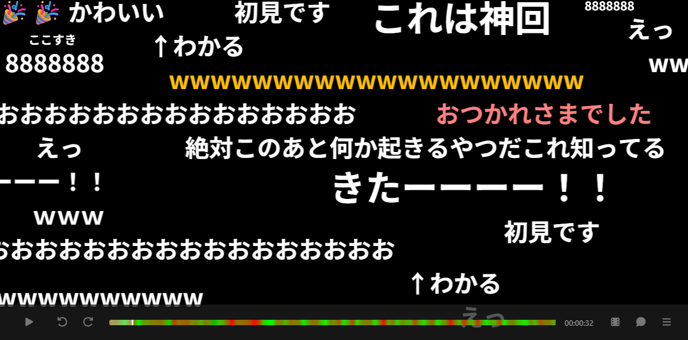

# jikkyo

ニコニコ動画風にコメントを流しながら動画を再生できる Web アプリです。ブラウザだけで動作し、ファイルはサーバーに送信されません。

**https://rot1024.github.io/jikkyo/**



## 特徴

- 動画ファイルとコメントファイルを読み込んで、コメントを動画に同期して流せます
- 動画なしでコメントだけを再生することもできます
- 対応コメント形式
  - ニコニコ動画のコメントファイル（XML）。`ue` / `shita` / `big` / `small` や色指定などのコマンドに対応
  - ASOBISTAGE のコメント（JSON）
- ボタンから開くほか、ウィンドウへのドラッグ＆ドロップで読み込めます（動画とコメントをまとめてドロップ可能）
- シークバーの色でコメントの盛り上がりを可視化
- コメントが急に増えた場面を自動で検出し、シークバー上のマーカー・メニューの「Highlights」一覧・`[` / `]` キーでジャンプ（盛り上がりの少し手前から再生）
- コメントの時刻ずれをキーボードで補正
- コメント検索（ハイライト表示と前後の検索結果への移動）
- 文字サイズの自動調整（デフォルト）：コメント読み込み時に混雑時のコメント量を見積もり、行数を最小〜最大行数の範囲で決めます。コメントが少ない動画では文字が大きく、多い動画では小さくなります（行数・フォントサイズの固定指定も可能）
- 表示のカスタマイズ：表示時間、不透明度、ユーザーごとの色分け、表示数の上限、間引き
- 正規表現によるミュート・フィルタ

## 使い方

1. 画面右下のボタンから動画ファイルとコメントファイルを開くか、ウィンドウにドロップします
2. 再生ボタン、`Space`、または画面のダブルクリックで再生・一時停止します
3. 画面をクリックするとコントローラーの表示・非表示を切り替えます
4. 右下のメニューボタンから設定・検索・ファイルを閉じる操作ができます

### キーボードショートカット

| キー | 操作 |
| --- | --- |
| `Space` | 再生 / 一時停止 |
| `←` / `→` | 10秒戻る / 進む |
| `Shift` + `←` / `→` | 1秒戻る / 進む |
| `,` / `.` | コメントを 1秒早める / 遅らせる |
| `/` | コメントの時刻補正をリセット |
| `[` / `]` | 前 / 次の盛り上がりへジャンプ |
| `Esc` | 設定パネルを閉じる |

## 開発

Node.js 22.12 以降が必要です。

```sh
npm install
npm run dev     # http://localhost:3000
```

| コマンド | 内容 |
| --- | --- |
| `npm run dev` | 開発サーバーを起動 |
| `npm run build` | 型チェックと本番ビルド（`dist`） |
| `npm run preview` | 本番ビルドをプレビュー |
| `npm test` / `npm run test:run` | テスト（watch / 1回のみ） |
| `npm run lint` | ESLint |
| `npm run check` | 型チェック・lint・テストをまとめて実行 |

### テスト・計測用の機能

- `?dummy` を付けて開くと、生成したダミーコメントを読み込みます（例：`/?dummy=50&burst=1000&minutes=10`。1秒あたりの件数、毎分最初の3秒の弾幕区間の件数、長さを指定可能）
- 開発サーバーで `/bench.html` を開き、コンソールで `await runBench()` を実行すると、コメントの配置計算と描画の速度を計測できます

### 技術スタック

React 19 / TypeScript / Vite / Emotion / Vitest。コメントは Canvas 2D で描画し、配置計算は Web Worker で行っています。

## デプロイ

- **GitHub Pages**：`main` に push すると GitHub Actions（`.github/workflows/pages.yml`）でビルド・デプロイされます。サブパスで配信するため `BASE_PATH=/jikkyo/` でビルドしています
- **Netlify**：`npm run build` でビルドした `dist` をルートで配信します（設定は Netlify 側）

## 旧バージョン

透明ウィンドウでコメントを流す Electron 製のデスクトップアプリ（v1）は [`master`](https://github.com/rot1024/jikkyo/tree/master) ブランチと [Releases](https://github.com/rot1024/jikkyo/releases) に残っています。旧紹介ページは [`lp`](https://github.com/rot1024/jikkyo/tree/lp) ブランチにあります。
